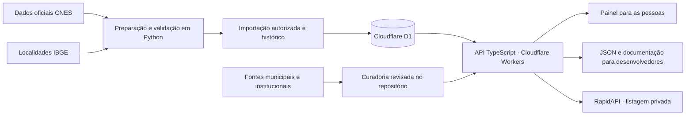

# 🌻 Rede Girassol API

**Informação organizada para facilitar a busca por serviços de saúde e apoio a pessoas autistas.**

Projeto independente de **[Rafael Ricardo Mayer](https://github.com/rafaelrmayer)**, com finalidade social: reunir informações públicas que estão espalhadas em diferentes fontes e tornar o próximo passo mais claro para quem procura atendimento.

O painel oferece uma interface para as pessoas; a API permite que desenvolvedores integrem os mesmos dados a sites, aplicativos e outros projetos. O objetivo principal é ajudar. Uma eventual receita futura será avaliada para sustentar infraestrutura e manutenção, sem promessa de monetização ou retorno financeiro.

[**Abrir o painel**](https://rede-girassol-api-v-1.rafael10mayer.workers.dev/) · [**Documentação interativa**](https://rede-girassol-api-v-1.rafael10mayer.workers.dev/docs) · [**OpenAPI**](openapi.json) · [**Portfólio**](https://rafaelrmayer.github.io/)

> **Tecnologia, informação e cuidado.**  
> *Rumo à utopia e ao horizonte.* 🌻

## O que já funciona

| Recurso | O que oferece |
|---|---|
| Estabelecimentos | Pesquisa por nome, cidade e UF, detalhe por ID/CNES e paginação. |
| Autismo e apoio | Instituições com atendimento a TEA documentado em fontes oficiais, público informado e orientação de acesso. |
| Reabilitação | Observações mensais do serviço CNES 135, com modalidade, competência e tipo próprio/terceiro. |
| Contatos institucionais | Telefones com botão para ligar, e-mail/site quando conferidos, fonte e data de revisão. |
| Encontre apoio · Experimental | Quatro orientações sobre acesso ao SUS, crianças/adolescentes, adultos e cuidadores, com resumos e passos. |
| Planos ANS | Catálogo nacional preparado para carga completa; situações, características e vínculo por registro da operadora. Menu liberado após validação remota. |
| Operadoras ANS | Consulta de cadastros ativos/cancelados após a primeira carga completa validada; filtros de sede e situação. |
| API para desenvolvedores | Respostas JSON, filtros, paginação, OpenAPI e documentação interativa. |
| Importação controlada | Scripts Python e GitHub Actions para preparar, validar, importar e conferir cargas CNES, com histórico. |

**Referência da base conferida em 23/11/2026:** 118 estabelecimentos correspondentes ao filtro Curitiba; 19 observações de reabilitação na competência **202607**; seis instituições na curadoria de autismo; contatos publicados para 17 dos 19 estabelecimentos da amostra de reabilitação. São números da carga inicial, não contagens em tempo real nem cobertura integral do município.

O conteúdo de atendimento a autistas documentado nesta etapa se refere a crianças e adolescentes. O piloto informa explicitamente a lacuna de serviços específicos para adultos; não afirma que esses serviços não existam.

## Para quem procura apoio

Abra o [painel público](https://rede-girassol-api-v-1.rafael10mayer.workers.dev/) sem precisar de chave RapidAPI:

1. Pesquise em **Estabelecimentos**, **Autismo e apoio** ou **Reabilitação**.
2. Confira público atendido, fonte e data de referência.
3. Use o contato publicado para confirmar critérios, encaminhamento e disponibilidade.
4. Consulte **Encontre apoio** para orientações curtas e passos de acesso.

O campo de pesquisa do Encontre apoio funciona por palavras no navegador. O texto digitado não é enviado pelo painel ao servidor nem persistido no banco. Os resumos são editoriais, revisados e identificados com fontes: **não há geração por IA, diagnóstico ou recomendação de tratamento**.

Contatos podem ser centrais administrativas compartilhadas, não linhas diretas de uma unidade. Um número publicado no CNES é identificado como cadastral e não se transforma automaticamente em WhatsApp. Contato ausente ou com revisão vencida aparece como **“Contato não confirmado”**.

## Para desenvolvedores

Base pública:

```text
https://rede-girassol-api-v-1.rafael10mayer.workers.dev
```

| Método | Rota | Uso |
|---|---|---|
| GET | `/health` | Disponibilidade do Worker; não testa o banco ou as fontes externas. |
| GET | `/sources` | Fontes e estágio das integrações. |
| GET | `/v1/places` | Lista de estabelecimentos; filtros `q`, `city`, `state`. |
| GET | `/v1/places/{place_id}` | Detalhe por ID interno ou CNES de sete dígitos. |
| GET | `/v1/autism-support` | Curadoria documental de atendimento a TEA; filtros `q`, `city`, `state`. |
| GET | `/v1/rehabilitation` | Observações de reabilitação por nome, local, classificação, CNES, tipo e competência. |
| GET | `/v1/plans` | Características cadastrais nacionais; filtros de plano, registro da operadora e situação, após carga completa. |
| GET | `/v1/operators` | Operadoras ANS; filtros por razão social, sede, situação e registro ANS, após a carga validada. |
| GET | `/v1/support-guide` | Corpus de orientações revisadas; sem parâmetros ou perguntas. |

Exemplos:

```http
GET /v1/places?city=Curitiba&state=PR&limit=10&offset=0
GET /v1/places/3295621
GET /v1/autism-support?city=Curitiba&limit=10
GET /v1/rehabilitation?classification_code=002&reference_month=202607&limit=2&offset=2
```

As cinco listas aceitam `limit` de 1 a 100 (padrão 100) e `offset` como quantidade de registros a pular. Retornam `results`, `count`, `total` e `pagination`, com `has_more` e `next_offset`. Detalhes, erros e demais filtros estão no [guia da API](docs/API.md).

Planos ANS possuem preparação nacional, envio em partes retomáveis e publicação somente após conferência do conjunto completo. O menu só aparece após a carga remota validada; antes disso, a consulta legada por nome permanece disponível. Veja os guias de [planos](docs/ANS_PLANS.md) e [operadoras](docs/ANS_OPERATORS.md). As rotas administrativas exigem token e não são oferecidas no marketplace.

## RapidAPI: integração testada, listagem privada

As sete consultas do piloto foram testadas pelo RapidAPI, incluindo filtros, paginação, detalhes, contatos e orientações. O acesso de integração utiliza o prefixo `/rapidapi` e valida o `X-RapidAPI-Proxy-Secret` enviado pelo gateway.

O BASIC foi configurado e conferido na interface em 23/11/2026:

- **US$ 0/mês** de assinatura.
- **1.000 chamadas por mês, com Hard Limit**.
- **10 chamadas por minuto**.

A plataforma apresenta uma **Bandwidth Platform Fee** separada: franquia de 10.240 MB por ciclo, com tarifa de excedente ao consumidor conforme as condições do RapidAPI. Não é uma promessa de ausência de qualquer tarifa da plataforma.

**A listagem continua privada.** A publicação depende da conclusão da revisão documental das fontes e da declaração exigida pelo marketplace. A configuração do plano não comprova, por si só, o bloqueio efetivo para uma conta consumidora; testes com a conta proprietária têm limitações.

A origem pública que atende o painel continua acessível. A proteção do namespace de integração não torna os dados exclusivos do RapidAPI e as cotas do gateway não são limites globais da infraestrutura.

Veja o [roteiro RapidAPI](docs/RAPIDAPI.md), a [definição preparada de nove consultas](rapidapi.openapi.json) e a [revisão documental das fontes](docs/SOURCE_REUSE_REVIEW.md).

## Fontes, datas e limites

- **CNES/Ministério da Saúde:** cadastros institucionais e observações mensais de serviços especializados.
- **IBGE:** conferência do nome do município e correspondência com UF nos preparadores.
- **Prefeitura de Curitiba:** informações explícitas de atendimento e orientações de acesso.
- **Páginas institucionais e CNES:** contatos com procedência individual.
- **ANS:** integração de operadoras ativas/canceladas implementada, com primeira carga e repetição confirmadas em produção em 24/11/2026. Catálogo nacional de planos preparado para a primeira carga remota; rede credenciada não integrada.

A curadoria de autismo é independente da classificação de reabilitação. **Reabilitação intelectual não confirma atendimento a TEA**, assim como cadastro CNES não comprova vínculo com plano de saúde ou habilitação como CER. A competência histórica não significa oferta atual, e `imported_at` não substitui a data da fonte.

A API não confirma vagas, linha telefônica ativa, elegibilidade para todas as idades ou acesso imediato. Ausência de resultado não significa ausência de atendimento na cidade. O modelo não reúne prontuários, CPF, endereço residencial ou histórico clínico de pacientes.

Resumos, contatos e evidências de atendimento possuem revisão com prazo; itens vencidos deixam de ser apresentados como vigentes. As cargas CNES são manuais e limitadas: ainda não há sincronização nacional ou acompanhamento automático de inativações.

| Guia | Conteúdo |
|---|---|
| [Planos ANS](docs/ANS_PLANS.md) | Fonte, carga nacional, limite diário de envio, retomada e conferência de capacidade. |
| [Operadoras ANS](docs/ANS_OPERATORS.md) | Primeira carga completa, migração, diferenças entre fontes e atualização mensal preparada. |
| [API](docs/API.md) | Contratos públicos, filtros, paginação e erros. |
| [Reabilitação e autismo](docs/REHABILITATION.md) | Fontes, classificação, curadoria, migração e carga mensal histórica. |
| [Contatos](docs/CONTACTS.md) | Canais institucionais, origem, contexto e prazo de revisão. |
| [Encontre apoio](docs/SUPPORT_GUIDE.md) | Busca documental, fontes, privacidade e limites. |
| [Operação e importação CNES](docs/OPERATIONS.md) | Preparação local, implantação e workflows pelo navegador. |
| [RapidAPI](docs/RAPIDAPI.md) | Configuração do gateway e etapas de publicação. |
| [Revisão de reutilização](docs/SOURCE_REUSE_REVIEW.md) | Condições encontradas, ressalvas e dúvida documental ainda registrada. |

## Como funciona



A consulta ao painel não baixa novamente os arquivos oficiais. Ela lê a base importada e o conteúdo revisado. Os workflows registram procedência, hashes e resultados; a importação usa transação e preserva a identidade dos cadastros.

**Tecnologias:** TypeScript, Cloudflare Workers, Cloudflare D1/SQLite, Python, GitHub Actions, Vitest, OpenAPI e interface web com HTML/CSS/JavaScript.

## Desenvolver e verificar

Requisitos: **Node.js 22.13 ou superior** (recomendado: 24), npm e Python 3.

```bash
npm ci
npm test
npm run typecheck
npm run test:cnes
cp .dev.vars.example .dev.vars
npx wrangler d1 migrations apply rede-girassol-db --local
npm run dev
```

Substitua o token fictício de `.dev.vars` antes de testar administração local. O banco local é separado do remoto. Esses comandos não implantam o Worker nem executam migração remota.

No ambiente remoto, `IMPORT_TOKEN` protege as importações e `RAPIDAPI_PROXY_SECRET` valida o gateway; ambos devem ser **Secrets** na Cloudflare, não valores no `wrangler.toml`. O workflow de importação usa `REDE_GIRASSOL_IMPORT_TOKEN` nos secrets do GitHub. Nunca publique valores em código, screenshots ou exemplos.

A verificação automática do repositório executa testes TypeScript, Python, checagem de tipos e build em dry-run. Os testes usam banco local/SQLite e dados de teste; não representam confirmação de atendimento pelas instituições.

## Próximas etapas

1. Concluir a revisão documental e a publicação no RapidAPI.
2. Conferir capacidade do D1, aplicar a migração 0004 e validar a primeira carga nacional de planos; a primeira carga e repetição de operadoras já foram confirmadas em produção.
3. Acompanhar a atualização mensal de operadoras ANS, com validação, comparação de alterações e histórico.
4. Conferir a primeira execução agendada, prevista para **02/12/2026 às 05h17 de Brasília**, sujeita a atraso do GitHub.
5. Manter revisão periódica de contatos e atendimento, priorizando informação útil em vez de ampliar o escopo sem necessidade.

O workflow atualiza operadoras ANS todo dia 2 às 05h17 de Brasília. É possível pausar o agendamento com a variável `ANS_MONTHLY_SYNC_ENABLED=false`, sem impedir a execução manual. A associação entre estabelecimento e rede de um plano exigirá fonte específica adicional.

## Autor e licença

**Rafael Ricardo Mayer** — desenvolvedor de software e pesquisador independente.

[Portfólio](https://rafaelrmayer.github.io/) · [GitHub](https://github.com/rafaelrmayer) · [Instagram](https://www.instagram.com/rafael_rmayer/)

Consulte [LICENSE](LICENSE) para as condições do código. Fontes e dados de terceiros têm condições próprias; a licença do código não os relicencia.

**Rede Girassol API — tecnologia, informação e cuidado.**
